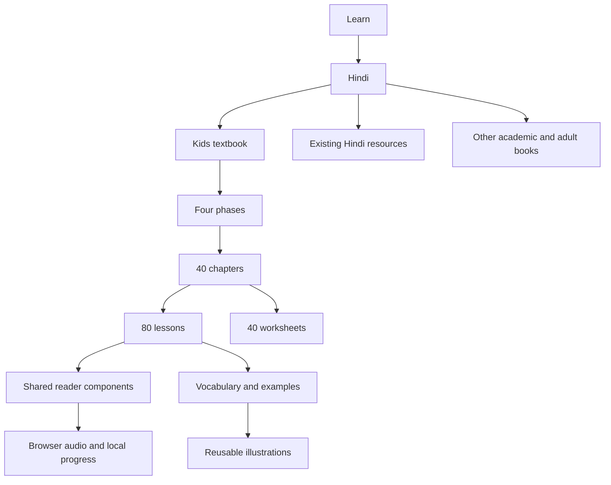

# Integrate, do not duplicate

These are proposed mapping decisions for the known default-branch routes, not a verified complete migration inventory. Keep every legacy URL and its indexing/progress contract until audited. The Kids book is separate educational content; its age-appropriate lessons must not be used to replace advanced or adult books. Shared educational assets may be reused.

| Existing resource | Kids reference / destination | Decision |
|---|---|---|
| `/learn/hindi/foundation/swar/` | phase-01 chapters 02–04, 10 | KEEP old route; reference / compare editorial content |
| `/learn/hindi/foundation/vyanjan-1/` | phase-01 chapter 05 | KEEP; review pronunciation examples |
| `/learn/hindi/foundation/vyanjan-2/` | phase-01 chapter 06 | KEEP |
| `/learn/hindi/foundation/vyanjan-3/` | phase-01 chapters 07–09 | KEEP |
| `/learn/hindi/foundation/bina-matra/` | phase-02 chapter 11 | KEEP deeper graded reading |
| `/learn/hindi/foundation/aa-ki-matra/` | phase-02 chapter 12 | KEEP |
| `/learn/hindi/foundation/i-ki-matra/`, `ee-ki-matra/` | phase-02 chapter 13 | KEEP |
| `/learn/hindi/foundation/u-ki-matra/`, `oo-ki-matra/` | phase-02 chapter 14 | KEEP |
| `/learn/hindi/foundation/ri-ki-matra/`, `e-ki-matra/`, `ai-ki-matra/` | phase-02 chapter 15 | KEEP |
| `/learn/hindi/foundation/o-ki-matra/`, `au-ki-matra/` | phase-02 chapter 16 | KEEP |
| `/learn/hindi/foundation/anusvar-visarg-chandrabindu/`, `sanyukt-akshar/` | phase-02 chapter 17 and phase-01 chapter 09 | KEEP |
| `/learn/hindi/foundation/pahli-kahani/` | phase-04 chapters 38–39 | KEEP old independent graded story |
| `/learn/hindi-barakhadi/` | phase-02 chapters 18–19 | KEEP as full reference |
| `/learn/hindi-how-to-write-vowels/`, `/learn/hindi-how-to-write-consonants/` | phase-01 writing | KEEP and verify stroke instruction before reuse |
| `/materials/`, `/toolbox/`, `/learn/practice/` | supplementary exercises | KEEP, review actual Hindi-specific entries |
| `/learn/hindi/beginner/`, `/learn/hindi/elementary/`, `/learn/hindi/intermediate/`, `/learn/hindi/advanced/` | subsequent progressive books | KEEP; classify and migrate in separate work |

## Logical model

Actual source and publishing: `curriculum.txt` + `art.json` → `build.py` → 165 static pages + manifest → review, registry and existing publisher. Site build and SEO contract remain authoritative. Do not delete or redirect routes based solely on this map.
