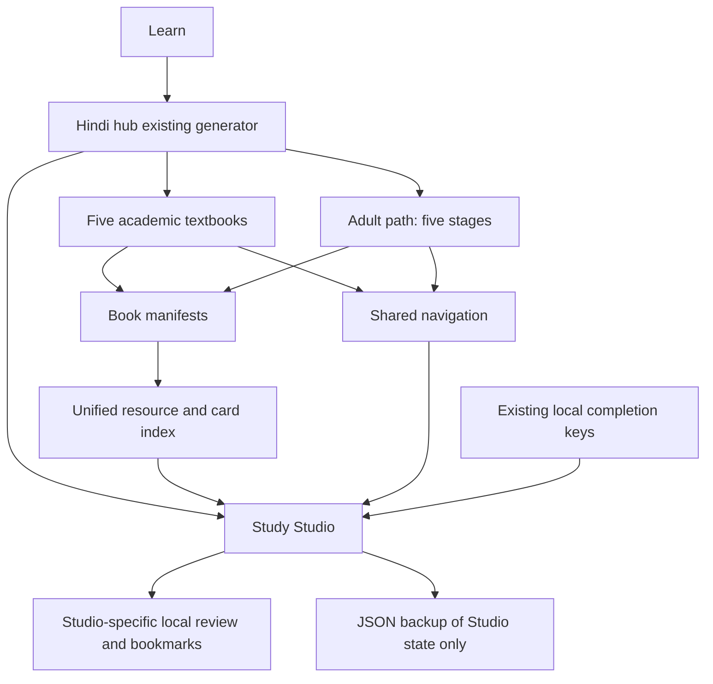

# Integrated Hindi architecture

The six existing textbook generators are preserved as separate content owners. The build stages their output and checks collisions before combining. Studio only reads actual published-to-package routes. Lesson and progress identifiers remain stable. No new server database is required. For a future book or language, extend the explicit book registry in `source/build_studio.py` and provide the corresponding generated manifest, art and routes. The current registry is Hindi-specific; a language-neutral registry is a future improvement.
