# Hindi textbook: architecture and migration checkpoint

Snapshot: working branch `arena/28510265-ekguru`, HEAD `d8f572a63694dd03c9256bec04214114c7f9183c`, 2026-11-28. The uncommitted prior Academy work is part of this branch. The inventory snapshots are `resource-inventory.json` and `resource-inbound-links.json`; `python3 tools/audit-hindi-textbook.py` refreshes both. The scan covers all public HTML for inbound anchors and candidate selection additionally considers Hindi language tags inside main content. It is **not** a complete editorial audit: dynamic links, CSS imports, generic unreferenced assets, externally hosted material and non-HTML content require further investigation. Metadata fields marked unassigned/not assessed are not claims of pedagogical quality. Identity route mapping is deliberate: preserve each existing URL until the owner approves a specific change.

The site deploys the static `_site` artifact via `.github/workflows/pages.yml` and `tools/build-public-dist.py`; no server redirect rule is configured here. Do not assume a permanent HTTP redirect. No production deploy or merge is authorized by this document.

## 1. System context
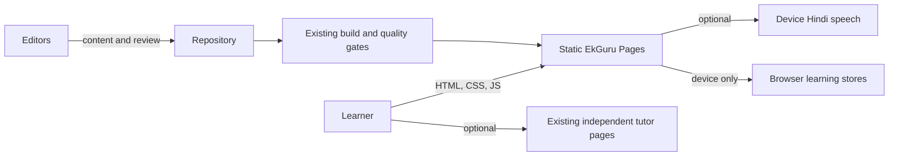
## 2. DFD level 0
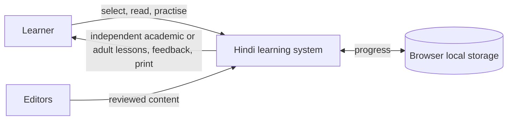
## 3. DFD level 1
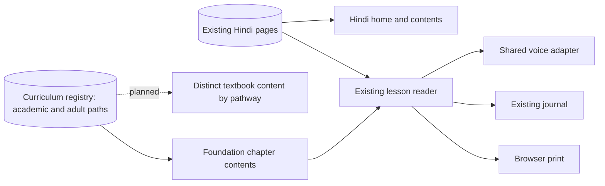
## 4. DFD level 2: publication
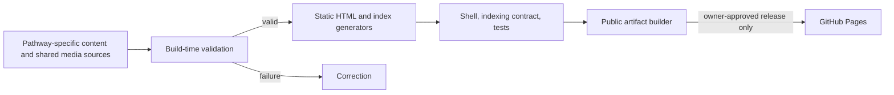
## 5. Logical ERD
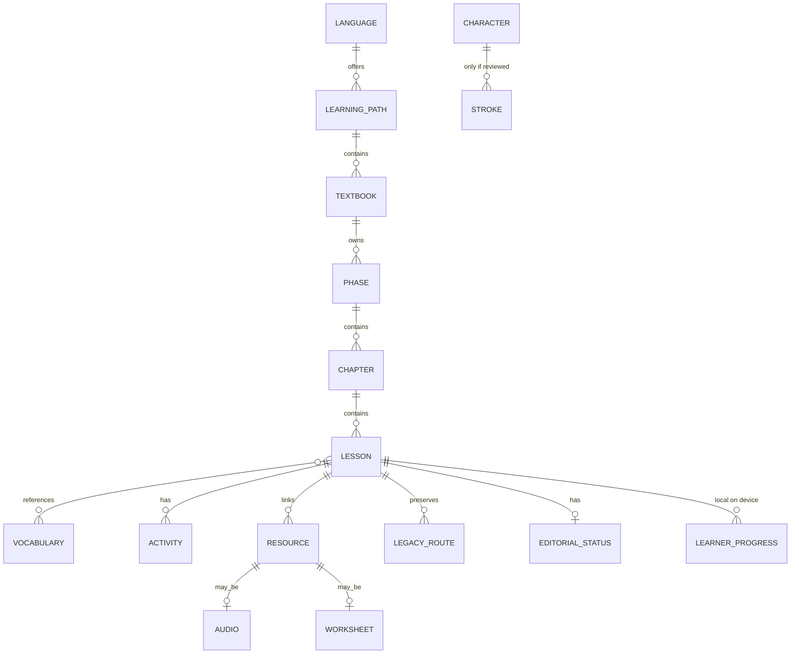
The diagram is a target logical model. Not all entities have implemented schema or reviewed records.

## 6. UML component diagram
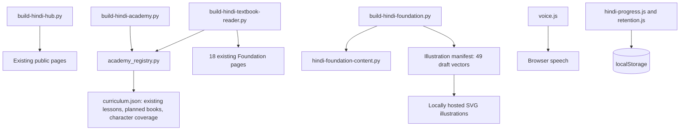
## 7. UML package diagram
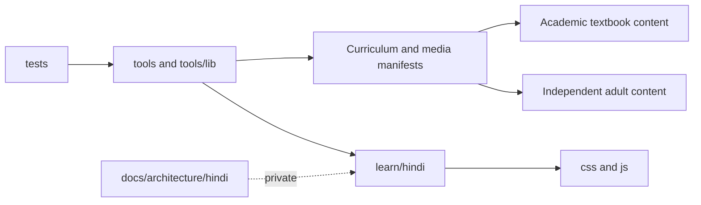
## 8. Learning activity
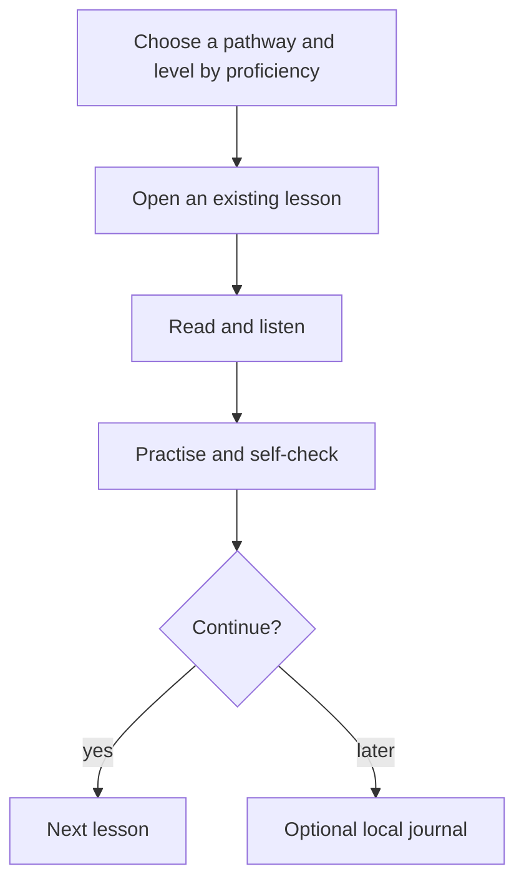
## 9. Chapter navigation state
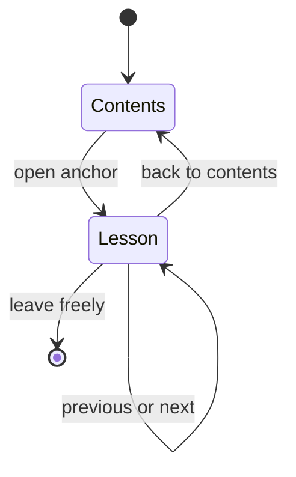
Navigation never requires assessment completion.

## 10. Learner interaction sequence
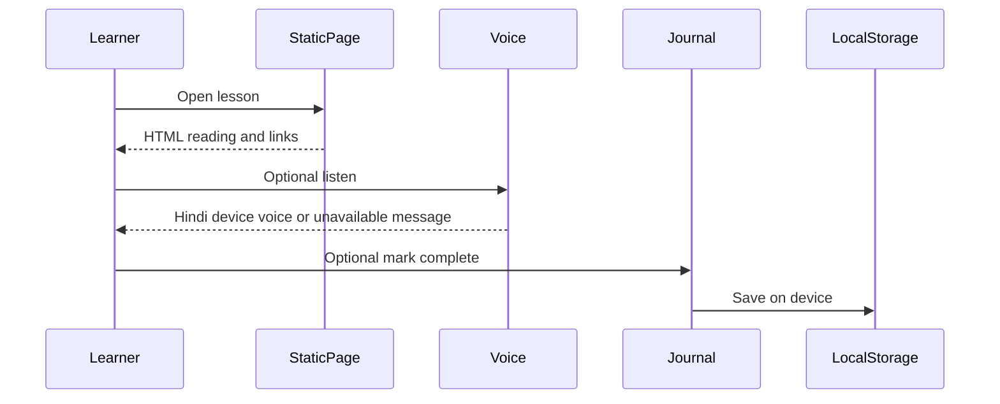
## 11. Content publishing sequence
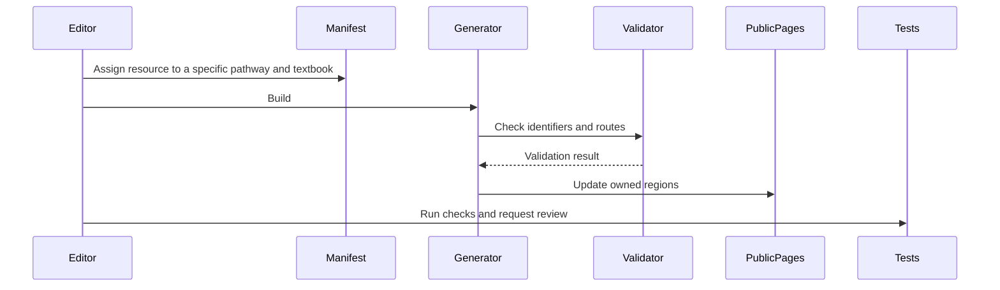
## 12. Repository dependency graph
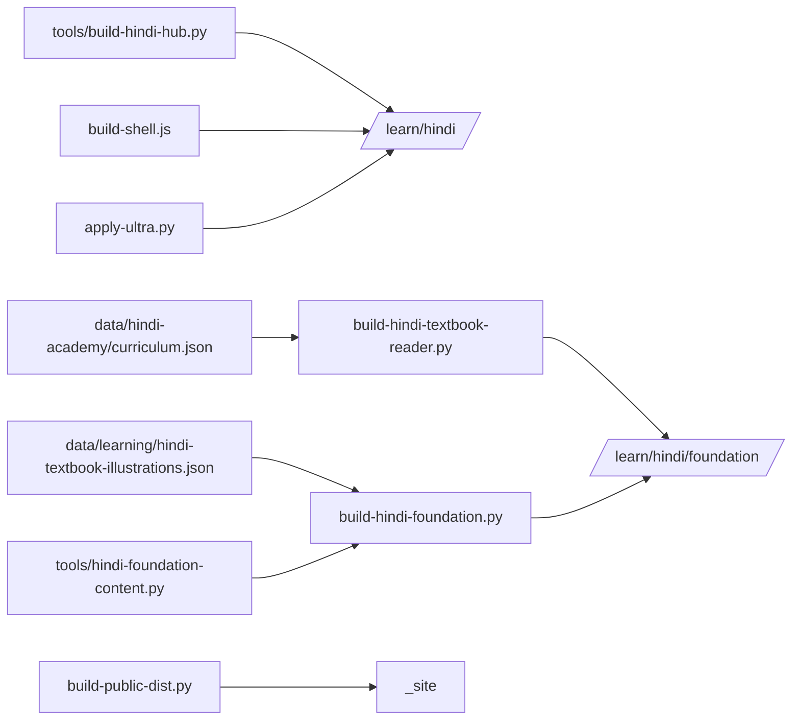
## 13. URL hierarchy
```mermaid
flowchart TD
 Home[/] --> Learn[/learn/]
 Learn --> Hindi[/learn/hindi/]
 Hindi --> Kids[/learn/hindi/kids/]
 Hindi --> Beginner[/learn/hindi/beginner/]
 Hindi --> Intermediate[/learn/hindi/intermediate/]
 Hindi --> Advanced[/learn/hindi/advanced/]
 Hindi --> Mastery[/learn/hindi/mastery/ planned]
 Hindi --> Older[/learn/hindi/older-adults/ planned]
 Older -. planned .-> AF[Adult Foundation]
 AF -. planned .-> AB[Adult Beginner]
 AB -. planned .-> AI[Adult Intermediate]
 AI -. planned .-> AA[Adult Advanced]
 AA -. planned .-> AM[Adult Mastery]
 Beginner --> Foundation[/learn/hindi/foundation/]
 Foundation --> Vowels[/learn/hindi/foundation/swar/]
 Hindi -. compatibility retained .-> Academy[/learn/hindi/academy/]
```
Kids, mastery, older-adults and all proposed phase routes are planned, not published. The existing beginner, intermediate and advanced pages are earlier material, not completed books. The current manifest references 18 existing Foundation lessons in the beginner book’s first planned phase; the generated navigation links to the existing URLs, not the planned phase URLs. No textbook is complete.

## 14. Existing-to-target migration map
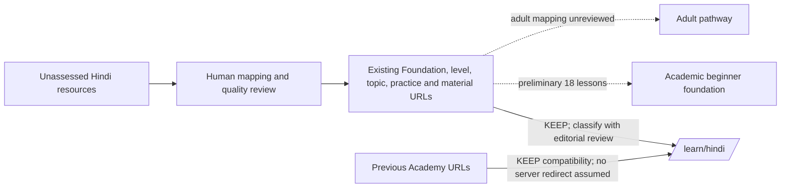
## 15. Editorial lifecycle
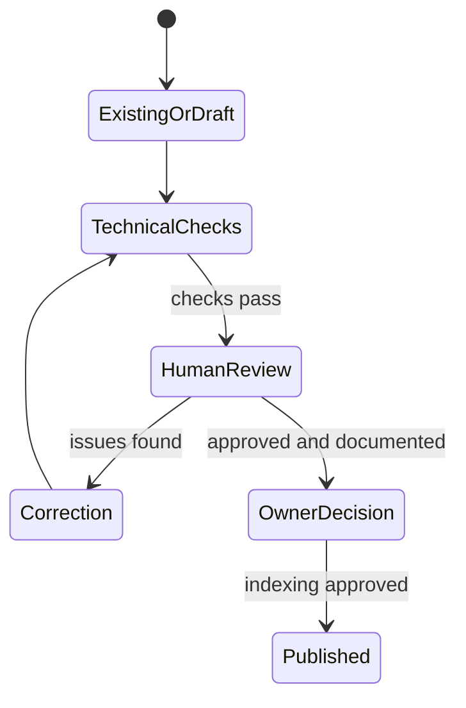

## Guardrails and open decisions

- Old routes and canonical relationships remain untouched until an explicit reviewed migration; the inventory defaults to KEEP rather than inventing MOVE/MERGE decisions.
- No high-quality stroke data has been verified. The current canvas is a printed-model trace and self-check, not a stroke-order animation or recognition.
- Reuse existing foundation, graded levels, daily course, topic lessons, worksheets and voice controls; collection links are not evidence of complete new dedicated courses.
- The legacy local journal and shared retention stores are not rewritten or migrated merely to create new navigation.
- New standalone route files remain noindex pending owner and editorial approval in accordance with the existing indexing contract. Shared resources are not silently duplicated.


## 16. Curriculum progression and prerequisite matrix (planned)

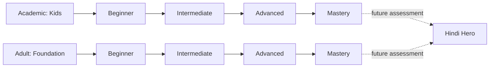

`data/hindi-academy/curriculum.json` contains each stage's immediate prerequisite, proposed entry/exit competencies, vocabulary and grammar scope, reading/writing/speaking/listening targets, and four phases. It records the 100 requested academic topics and 100 preliminary adult topics as **planned labels, not authored chapters or assessments**. Academic age/class guidance is an independent design analogy, not a board qualification, a prerequisite or an age restriction; learners may start by proficiency. The adult pathway requires independently authored mature content, not copies of the academic lessons. Placement and assessment criteria, individual learning objectives, precise vocabulary targets, differentiated content, phase pages and a complete dependency map remain to be developed and reviewed. No Hindi Hero credential exists yet.

The shared software component renders owned textbook content; it is not a single shared textbook. The 18 existing Foundation pages are preliminarily mapped only to academic Beginner, while the adult pathway is unfilled. Shared visual and vocabulary identifiers can be reused, but existing lesson IDs cannot be counted as chapters of multiple textbooks.
